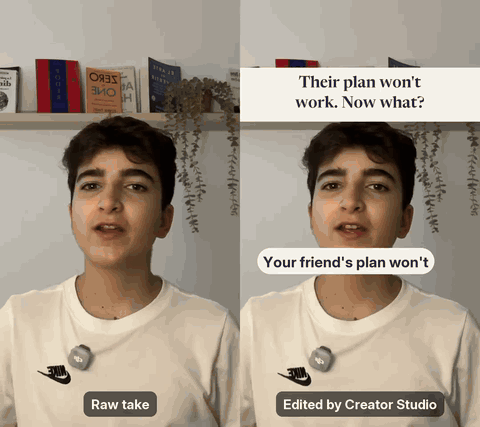
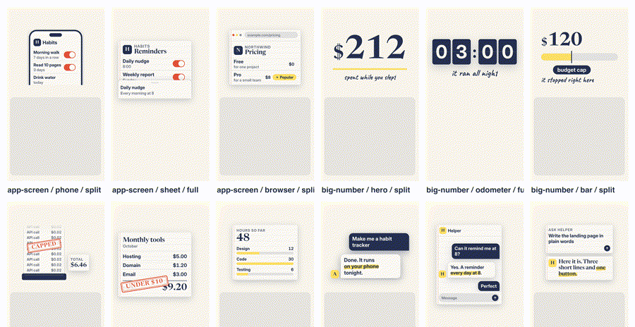
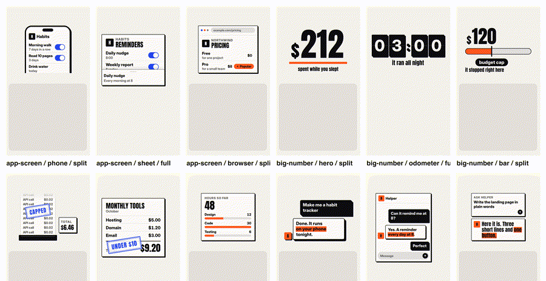
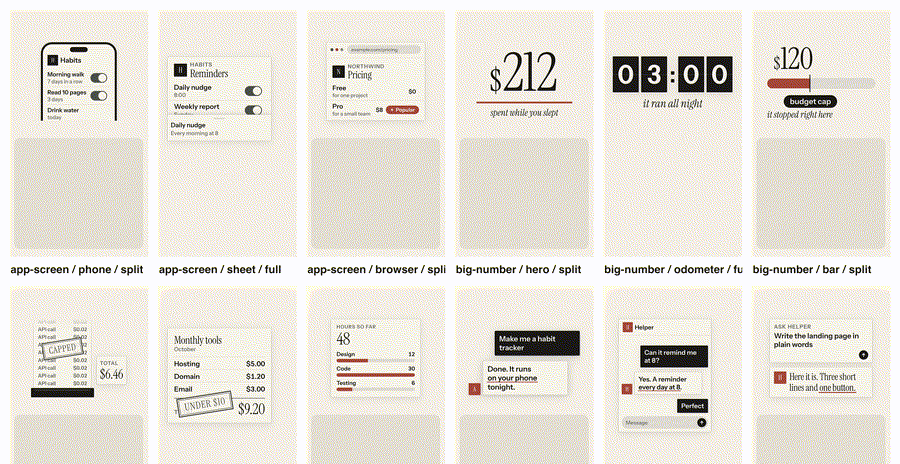

# Creator Studio

**Pick a name and a look. Hit record. Get Shorts, long videos, titles and a posting kit back.**

<p align="center"></p>

<p align="center">One of my real takes. Left: what I recorded. Right: what the agents made from it, with no
edits by hand. <a href="docs/demo/before-after.mp4">Watch the full 49 seconds with sound.</a></p>

Creator Studio is a complete video studio for people who film themselves. You write one small file
with your channel's name, colours and voice. Then a desktop app gives you ideas and talking points
in that voice, a recorder shows them on a teleprompter, and Claude Code agents edit every take:
the cut, the captions, the motion graphics, the cover and the text for every platform.

You record. It does the rest. Nothing is posted for you; you get files ready to post.

| Notebook | Bold | Editorial |
|---|---|---|
|  |  |  |

Same components, three looks. Change one line in `brand.json` and every caption, graphic, cover and
end card changes with it.

## Why this exists

Open-source video tools each do one stage. Faceless generators make a video without you. Clippers
cut up a video you already made. Editing skills start after you hit record.

This is the whole loop, for a person on camera:

```
ideas → talking point cards → teleprompter + takes → cut → design → captions + motion → cover → posting kit
 Studio app                     Recorder app         Claude Code agents ────────────────────────────►
```

It is the system I use to run my own channels, cleaned up so anyone can use it.

## What you get

- **Studio** (desktop app, Tauri). Ideas, a week of Short cards, long video maps or scripts, three
  thumbnail ideas, descriptions and chapters, a film day list, your edits and your daily kit. Every
  prompt is written in your brand's voice.
- **Recorder** (native macOS app). Teleprompter that follows your voice, camera, screen, mic and
  system audio on one clock, a camera bubble, iPhone screen over USB, click highlights with auto zoom,
  vertical Short mode with face framing, countdown, hotkeys and a Bluetooth clicker
  (one press starts or stops, two presses throw the take away).
- **Editing agents** (Claude Code). A creative director on Opus decides what each video should feel
  like and what goes on screen at every beat. An editor on Sonnet runs the build. A QA agent opens
  real frames of the finished cut before you see it.
- **Pipeline** (Python, ffmpeg, whisper.cpp). Word timings, a cutter that removes retakes, false
  starts, fillers and dead air (and keeps deliberate repeats when there is a script), four rotating
  Short layouts, captions with one emphasis word per line, covers, sound, safe zone checks for every
  platform, and long video builds with a camera bubble and chapters.
- **Motion kit** (HyperFrames). 15 brand tokened components: app screens, big numbers, bills,
  chats, comparisons, flows, logo rows, source cards, stamps, terminals, lower thirds, chapter
  cards, progress, callouts and quotes.
- **Posting kit**. A folder per day with every video, cover and caption ready to copy.

## Quick start

You need a Mac (the pipeline and Studio also run on Linux; the Recorder is macOS only),
[Claude Code](https://claude.com/claude-code) logged in, and [Homebrew](https://brew.sh).

```bash
git clone https://github.com/PepSecanell/creator-studio
```

```bash
cd creator-studio && ./studio setup
```

`setup` installs ffmpeg, whisper.cpp and Node, creates a Python environment, downloads the speech
model and the motion kit, and writes `~/.config/creator-studio/config.json`.

```bash
./studio demo --offline
```

That runs the whole Shorts loop on a built in test take and writes a finished video, a cover and the
posting text into `workspace/edits/shorts/demo/`.

Then make it yours:

1. Edit `brand/brand.json`: name, look (`notebook`, `bold` or `editorial`), colours, voice, handles.
   Drop a `logo.png` next to it.
2. `./studio brand build` and `./studio brand preview` to see your captions, hook card, end card and
   cover.
3. Build the apps: `apps/studio/build.sh` and `apps/recorder/build.sh`.
4. Open Studio, make a week of cards, press Record on one, film it.
5. `./studio edit pending`, or open the edit from Studio and press Edit now.

## The brand file

`brand/brand.json` is the only file you edit.

```json
{
  "schema": "creator-brand/v1",
  "name": "Northwind",
  "style": "notebook",
  "palette": { "ground": "#F7F5EF", "ink": "#1F2433", "accent": "#FFD84D",
               "accent_2": "#2F6BFF", "muted": "#8A8F9C", "on_accent": "#1F2433" },
  "voice": {
    "who": "A designer who builds tiny tools at night",
    "audience": "People who want to make their first app",
    "tone": ["plain words", "warm", "a bit dry"],
    "banned": ["game changer", "unlock"],
    "cta": "Follow for one small build a day",
    "link": "example.com"
  }
}
```

The full schema is in [docs/CONTRACTS.md](docs/CONTRACTS.md).

## How the editing works

```
./studio words     word timings (whisper.cpp)
./studio cut       retakes, fillers, silences out
creative-director  writes creative.json: the look, a layout and a graphic per beat     (Opus)
./studio spec      turns the plan into a build spec, no design decisions
./studio render    renders the motion graphics in your brand tokens
./studio build     cuts, layouts, captions, motion, sound, loudness
./studio cover     cover and thumbnail base
./studio package   titles, captions, hashtags, pinned comment, description
qa                 opens real frames, fixes what a re-render can fix                   (Sonnet)
```

Splitting design from execution mattered more than any single tool. When one agent did everything,
every video came out looking the same. The creative director only makes decisions; the editor only
executes them.

Every LLM call goes through your own Claude Code login. There are no API keys to paste.

## Running it overnight

Want the edits done while you sleep? Schedule `./studio edit pending` with cron or launchd. Each run
edits every take that has no finished edit yet and leaves the results in `workspace/edits/`.

## Project layout

```
brand/          your brand file and logo
looks/          notebook, bold, editorial (look.json, tokens.css, OFL fonts)
apps/studio/    the Studio desktop app (Tauri 2)
apps/recorder/  the Recorder (Swift, macOS)
cstudio/        the Python pipeline and the ./studio CLI
motion/         the HyperFrames motion kit
.claude/        the agents and skills Claude Code uses
docs/           contracts and notes
workspace/      your ideas, takes, edits and kits (never committed)
```

## Tests

```bash
.venv/bin/python -m pytest -q
```

Studio: `cd apps/studio/src-tauri && cargo test`. Recorder: see `apps/recorder/README.md`.
Motion: `cd motion && npm test`.

## Status

This is v1. The pipeline, the agents, the motion kit and both apps build and pass their tests. Face
tracking uses OpenCV, so framing on Linux and macOS works the same. Safe zone numbers per platform are
careful estimates. Issues and pull requests are welcome.

## License

MIT. Fonts in `looks/*/fonts` are under the SIL Open Font License; each family has its licence file
next to it. The motion kit renders with [HyperFrames](https://github.com/heygen-com/hyperframes)
(Apache 2.0).

Made by [Pep Secanell](https://pepsecanell.com) · [@Pep_Secanell](https://x.com/Pep_Secanell)
